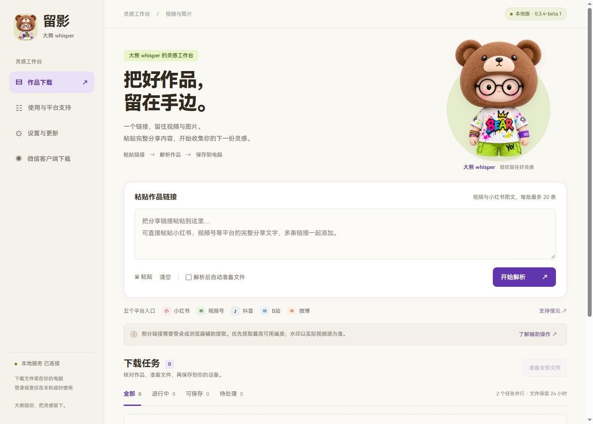

# 留影 · 大熊 whisper

### 把好作品，留在手边。

**在 Windows 电脑上，保存视频、整理小红书图文，也能从微信客户端辅助保存视频。**

[**⬇ 下载 Windows 安装包**](https://github.com/Whisper-5122/liuying/releases/download/v0.3.4-beta.1/Liuying-Setup-0.3.4-beta.1-win64.exe)　｜　[版本说明](https://github.com/Whisper-5122/liuying/releases/tag/v0.3.4-beta.1)　｜　[安装与使用](docs/使用指南.md)　｜　[反馈问题](https://github.com/Whisper-5122/liuying/issues/new)

Windows 10 / 11 x64 · 当前版本 **0.3.4-beta.1（测试版）** · 安装包约 **81 MB**

## 留影是什么？

留影是一个在自己电脑上运行的媒体下载工具。看到想留存的视频或图文，把完整分享链接粘贴进来，核对作品后准备文件，再保存到电脑。适合日常收藏、灵感整理，以及保存你自己发布或获准使用的内容。

它提供小红书、抖音、B站、微博等分享链接入口；微信视频号另有「微信客户端下载」入口。Python 和 FFmpeg 已打包，不需要自己配置开发环境。

## 可以用它做什么

| 你想做的事 | 留影里的操作 |
| --- | --- |
| 一起处理多条分享链接 | 一次粘贴最多 **20 条**，查看进度，失败后单独重试 |
| 保存视频 | 解析作品、准备文件，支持预览与保存 MP4；优先获取平台可提供的画质 |
| 收集小红书图文 | 按原顺序查看图片，可逐张保存，也可一键保存全部图片 |
| 保存电脑微信里可播放的视频 | 使用「微信客户端下载」，在微信播放后回到留影保存 |
| 整理自己的素材文件夹 | 在「设置与更新」选择保存位置；同名文件自动编号 |

## 下载后，四步开始

1. **下载安装包**：点击上方「下载 Windows 安装包」，选择 `.exe` 文件，不需要下载源码 ZIP。
2. **安装并打开**：双击安装，完成后打开桌面上的「留影」。
3. **粘贴分享内容**：把平台复制的完整分享文字粘贴进来，点击「开始解析」。
4. **核对并保存**：视频准备完成后点击「保存 MP4」；图文点击「查看图片」，再逐张或批量保存。

> 「解析成功 / 可保存」是文件准备状态。点击保存按钮后，才会另存到你选定的文件夹。默认使用 Windows「下载」文件夹，可在设置中更改。

*图集截图使用大熊 whisper 品牌素材演示浏览与保存入口，不展示真实用户的任务或账号，也不代表一次新的平台下载测试。*

## 微信视频怎么下载？

打开左侧 **「微信客户端下载」**，按窗口里的提示操作：

1. 点击「开启辅助」，阅读并确认提示。
2. 在**电脑微信**中重新打开目标视频，播放几秒。
3. 回到留影，在捕获列表中找到视频，点击「下载并保存」。

辅助开启期间会临时使用本机代理和专用证书；关闭辅助或退出留影会恢复。已有本机 HTTP 代理可自动衔接，其他代理配置可能需要按提示处理。只处理你在微信中能正常播放的视频，实际可用性会受微信版本、账号和网络条件影响。

## 平台支持与实际验证

| 平台 | 可处理内容 | 当前验证情况与使用条件 |
| --- | --- | --- |
| 小红书 | 视频、图文图片 | 已有真实视频与图文样本验证；部分作品需要自己的登录状态或浏览器辅助 |
| 抖音 | 公开视频分享链接 | 0.3.4 版真实样本已下载并通过音视频解码检查；受限作品仍可能需要登录辅助 |
| B站 | 单条视频分享链接 | 真实样本已下载，含 1080p 样本及音视频合并验证；可用画质取决于平台与账号 |
| 微博 | 视频分享链接 | 已有真实样本验证，包含 480p 样本；画质以实际视频源为准 |
| 微信视频号 | 电脑微信中播放的视频 | 使用独立的客户端辅助入口；已有用户反馈成功，不能保证所有微信版本和视频都可下载 |

样本成功不等于所有作品都能下载。工具不会移除已嵌入画面的水印，也不承诺全部内容无水印。当前主要面向单条作品；不提供合集批量抓取或直播录制。

## 常见问题

<strong>我不会用 GitHub，应该点哪里？</strong>

直接点击本页最上方「下载 Windows 安装包」即可。如果打开了版本发布页面，在 **Assets / 附件** 中选择 `Liuying-Setup-0.3.4-beta.1-win64.exe`。`Source code` ZIP 不是安装程序。

<strong>需要安装 Python 或 FFmpeg 吗？</strong>

不需要，安装包已经包含。若电脑缺少 Microsoft WebView2，安装程序会联网安装运行时。

<strong>为什么有些链接解析失败，或提示需要辅助？</strong>

先确认链接仍有效、作品在原平台能正常打开。需要登录时，在「设置与更新」按说明使用自己的浏览器登录状态，再回任务点击「重试解析」。微信视频优先使用「微信客户端下载」入口。

[查看详细操作与问题反馈方式](docs/使用指南.md#解析失败时怎么处理)

<strong>旧版怎么升级？保存的文件会不会丢？</strong>

先关闭留影，再运行新安装包，覆盖安装到原目录。设置、任务与已另存的成果位于安装目录之外，正常覆盖升级会保留。当前线上自动更新源尚未启用，请从本仓库下载新安装包升级。

<strong>文件和登录状态放在哪里？</strong>

另存的图片与视频位于你选择的文件夹，任务和设置保存在本机。准备文件的临时缓存保留 24 小时，已另存成果不参与这项清理。平台临时 Cookie 仅保存在本机服务内存中，2 小时后失效，退出或更新重启后清除。

## 测试版说明

- 面向 **Windows 10 / 11 x64**；目前完成的是 Windows 10 本机验证，尚未在 Windows 11 或其他干净电脑上完整验收。
- 安装包尚未进行 Windows 代码签名。发布页附有 [SHA256SUMS.txt](https://github.com/Whisper-5122/liuying/releases/download/v0.3.4-beta.1/SHA256SUMS.txt)，可用于核对文件完整性。
- 第三方组件许可证随安装包提供。微信辅助组件采用 **MIT with Commons Clause**；收费销售需另获授权。
- 请保存和使用你拥有权利或获得许可的内容，并遵守来源平台规则。

## 遇到问题，告诉我

[**提交问题反馈**](https://github.com/Whisper-5122/liuying/issues/new)时，请写上留影版本、Windows 版本、出问题的平台、操作步骤与错误提示。可以附界面截图；不要公开 Cookie、登录配对码或其他账号凭据。

---

**留影 × 大熊 whisper**  
把好作品，留在手边。

[下载安装](https://github.com/Whisper-5122/liuying/releases/tag/v0.3.4-beta.1) · [使用指南](docs/使用指南.md) · [问题反馈](https://github.com/Whisper-5122/liuying/issues)

