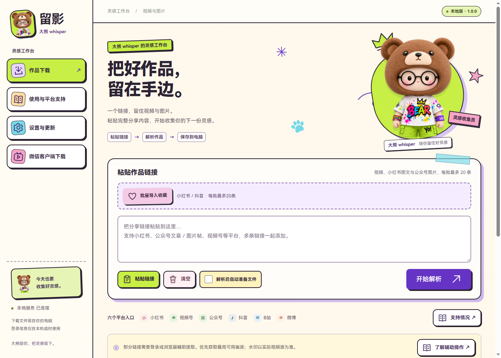
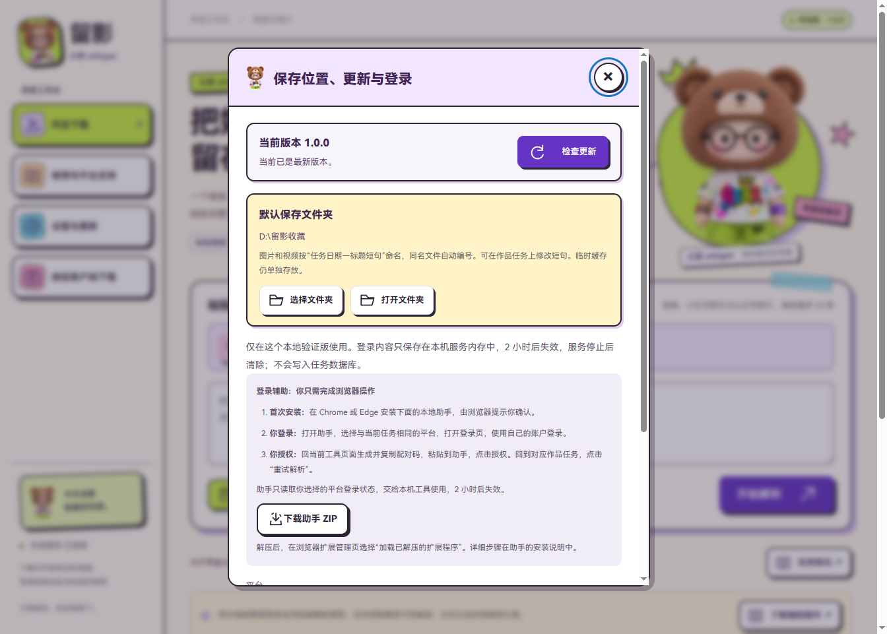
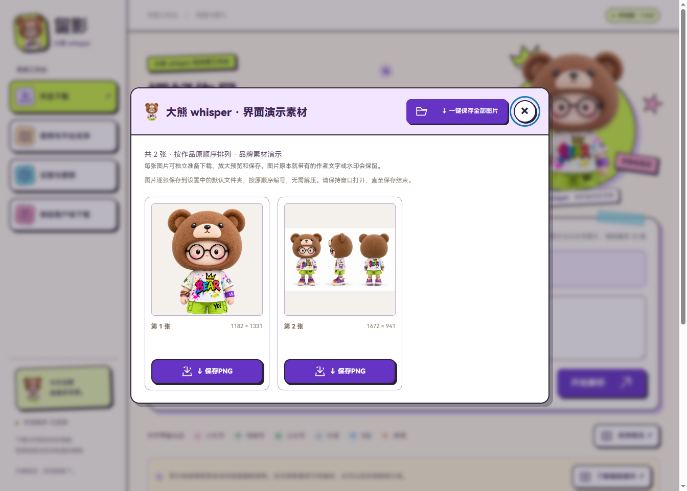
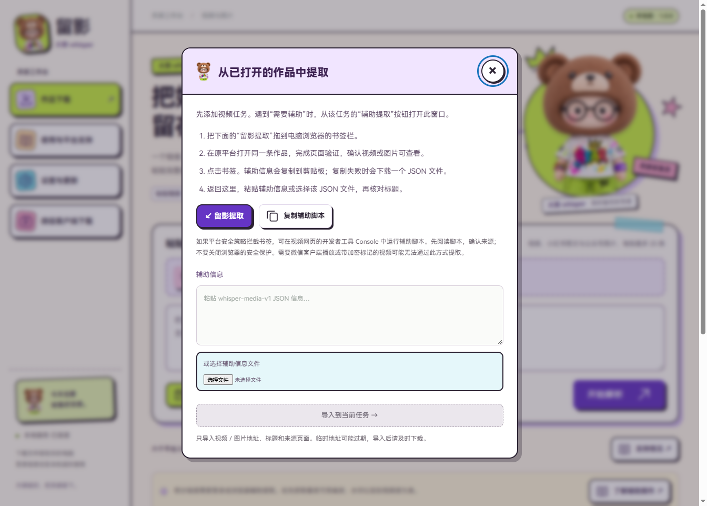
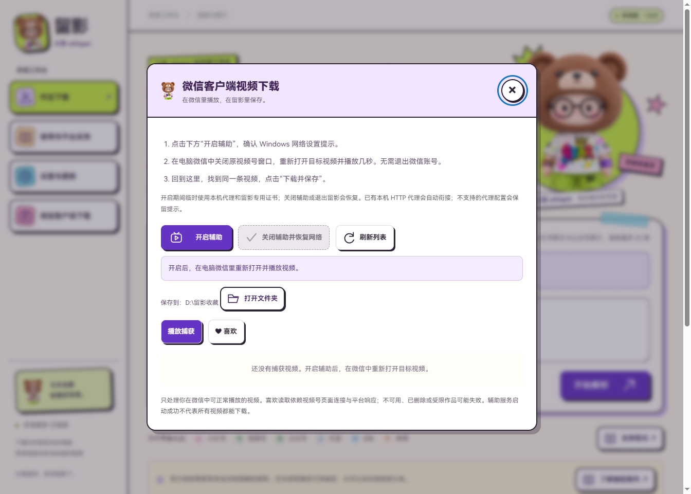

# 留影 V1 · 大熊 whisper

### 把好作品，留在手边。

Windows 视频与图片下载工具。粘贴分享链接，核对作品，再保存到自己的电脑。

[**⬇ 下载 V1 Windows 安装包**](https://github.com/Whisper-5122/liuying/releases/download/v0.3.4-beta.1/Liuying-Setup-win64.exe)　｜　[**新手图文指南**](docs/使用指南.md)　｜　[1.0.1 版本说明](https://github.com/Whisper-5122/liuying/releases/tag/v1.0.1)　｜　[反馈问题](https://github.com/Whisper-5122/liuying/issues/new)

Windows 10 / 11 x64 · 当前版本 **V1 · 1.0.1（微信 4.2 兼容修复）** · 安装包约 **81 MiB**

**原分享网址继续使用，上面的原下载入口已更新为 V1。** V1 包含此前 0.3.9 的界面、收藏导入与下载功能，正式版本号从 1.0.0 开始。无需注册 GitHub，不需要安装 Python 或 FFmpeg；不要下载 `Source code` 源码 ZIP。

## 微信 4.2 播放后没有记录？先更新到 1.0.1

微信 4.2 的部分视频页不再使用旧网页，V1（1.0.0）的辅助可能已开启却始终没有记录。**1.0.1 新增原生播放捕获**，已在微信 **4.2.0.13** 完成一条约 11.4 MB 真实视频的下载、完整解码和用户画面核对。

用法仍是「微信客户端下载 → 开启辅助 → 重新打开并播放视频 → 下载并保存」。新版记录按捕获时间和文件大小显示，可能含预加载视频；请保持目标视频播放并核对保存后的画面。首次下载会询问是否允许在本机只读查找微信视频进程中的媒体缓存；不会保存或上传进程内存，不修改微信。不授权则不会进行该匹配。

**边界：微信 4.2 的 ❤ 喜欢列表尚未恢复，使用播放捕获逐条下载。** 旧网页连接可用时仍保留原来的喜欢读取方式。单条样本通过不等于所有微信版本、账号和视频都可用。[新版视频号完整教程](docs/使用指南.md#视频号)

## 以后更新，还要重新下载吗？

**已支持客户端内更新。** 打开留影 → 左侧 **「设置与更新」** → **「检查更新」** → 发现新版后点 **「立即更新」**，软件会下载、校验、安装并重新打开。由你点击开始更新，下载过程中请保持软件开启。

| 当前版本 / 状态 | 怎么升级 |
| --- | --- |
| 0.3.6～0.3.9，或 V1，且更新源可用 | 在软件里「检查更新 → 立即更新」，不用每次到 GitHub 下载 |
| 0.3.5 及更早，提示更新未配置 / 按钮不可用 | 关闭留影，下载 V1，按原目录覆盖安装一次；以后在客户端更新 |
| 早期版本曾修复更新源，已能检测到 V1 | 直接点击「立即更新」 |
| 检查时网络失败 | 先重试；仍失败时用本页安装包覆盖安装 |

升级保留任务记录、保存位置和已保存文件。登录辅助是临时授权，重启后可能需要重新配对；浏览器通常仍保持登录。任务缓存不是长期备份，需要的作品请实际保存到文件夹。

## 第一次使用，四步保存

1. 点击上方 **「下载 V1 Windows 安装包」**，双击下载的 `.exe`，按提示安装，打开桌面「留影」。
2. 从平台复制完整分享文字，粘贴到 **「粘贴作品链接」**，点击 **「开始解析」**，每批最多 20 条。
3. 核对标题。视频按提示 **「准备视频文件」**；图文点 **「查看图片」**。也可先勾选「解析后自动准备文件」。
4. 就绪后，视频点 **「保存 MP4」**；图片点单张保存，或 **「一键保存全部图片」**，到设置中的文件夹检查。

> **「可保存」表示已准备好，点保存才会写到目标文件夹。** 默认使用 Windows 下载文件夹，可在设置中更改。同名文件自动编号，任务上的「文件命名」可修改标题短句。

## 按内容选入口：哪些需要辅助？

| 内容 | 先怎么做 | 受限时 / 详细说明 |
| --- | --- | --- |
| 小红书视频、图文；抖音、B站、微博视频 | 主页粘贴完整链接 → 开始解析 → 保存 | 按任务提示使用浏览器提取或自己的[登录辅助](docs/使用指南.md#登录助手) |
| **公众号文章插图、图片帖 / 贴图** | **先粘贴链接直接解析**，成功后「查看图片」 | 同一文章在 Edge / Chrome 打开，用「留影提取」书签后导入；[逐步图文教程](docs/使用指南.md#公众号图片) |
| **微信视频号视频** | 左侧 **「微信客户端下载」** → 开启辅助 → 电脑微信重新打开并播放 | 回留影刷新列表 → 下载并保存；[完整步骤](docs/使用指南.md#视频号) |
| **视频号 ❤ 喜欢** | 旧网页连接可用时：「微信客户端下载 → ❤ 喜欢」 | 微信 4.2 原生页面暂不支持此列表，请改用播放捕获逐条下载 |
| **自己的小红书 / 抖音收藏** | 「批量导入收藏」→「留影收藏」书签 → 导入清单 | 先滚动加载更多作品，再继续读取；[收藏导入教程](docs/使用指南.md#收藏批量导入) |

「贴图」指作品中的图片 / 图片帖，不包含微信表情包商店。公众号支持文章图片，不据此保证所有内嵌视频都能下载。

## 公众号与视频号，辅助方式不同

**公众号图片：** 可以直接读取时不用辅助。受限或没有图片时，在电脑浏览器打开**同一文章**、完成验证、滚动加载，再点任务的「辅助提取」。[不会创建书签？按指南操作](docs/使用指南.md#公众号图片)。

**视频号：** 用电脑微信专用入口，开启前阅读网络 / 证书提示。关闭旧视频窗口，重新打开并播放几秒，回留影保存。结束后点 **「关闭辅助并恢复网络」**；只关面板不会停止辅助。期间临时使用本机代理和专用证书，停止辅助或退出留影会恢复。

**三个工具分清楚：**「留影提取」用于当前单条作品；「留影收藏」用于自己的收藏列表链接；「留影浏览器登录助手」扩展仅在需要登录时使用。视频号 ❤ 喜欢使用微信面板，不用收藏书签。

## 实际支持范围

已有小红书视频与图文、公众号文章 / 图片帖、抖音、B站、微博真实样本验证。公众号历史样本含普通文章 35 张、图片帖 18 张；视频号 ❤ 喜欢在 0.3.8 使用微信 4.1.15.13 验证过读取与下载，V1 保留功能并做回归检查。样本成功不代表每个作品、账号、微信版本都可用。

- 优先使用平台当前可提供的画质，不移除原图 / 视频已嵌入的文字、水印。
- 收藏导入每批最多 20 条、每轮最多 200 条，只读网页已加载的链接，不保证读取全部历史收藏。
- 登录、验证、加密、权限或失效链接可能导致失败，不承诺绕过平台限制。
- 微信辅助可衔接已有本机 HTTP 代理；PAC、按协议或远程代理配置可能不支持，按软件提示处理。
- 当前为 Windows 桌面版，手机网页服务尚未发布，不含直播录制。

## 卡住了，先看这里

| 情况 | 下一步 |
| --- | --- |
| 可保存，但文件夹没有文件 | 点任务 / 图集里的保存；准备与另存是两步 |
| 原生窗口拖不动书签 | 按指南在浏览器管理器里手动创建 |
| 公众号没有图片 | 同一原文在浏览器滚动加载后做辅助，不要误用视频号捕获 |
| 辅助已开启，但没有微信视频 | 关旧视频窗口再重开播放；已开启不等于已连接微信 |
| 重启后又要求登录辅助 | 临时授权已清除，重新配对；不一定需要重新输入密码 |
| 更新失败 | 稍后重试；或退出留影后，用 V1 安装包按原目录覆盖安装 |

[**打开完整新手指南：安装、公众号、视频号、收藏、登录、更新与故障处理 →**](docs/使用指南.md)

截图来自 1.0.0 实际桌面界面的独立演示资料，展示沿用的操作入口，不含真实用户账号；1.0.1 新增原生捕获，相关步骤见指南。图集使用自有品牌素材，微信截图未开启网络辅助。请只保存自己有权保存和使用的作品。
