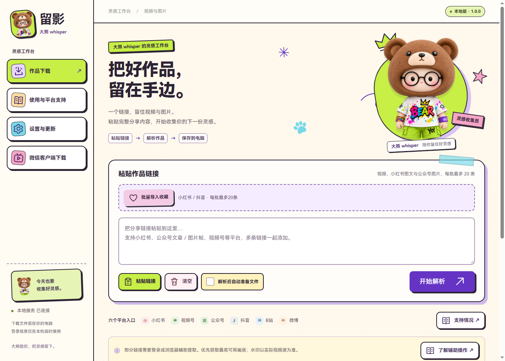
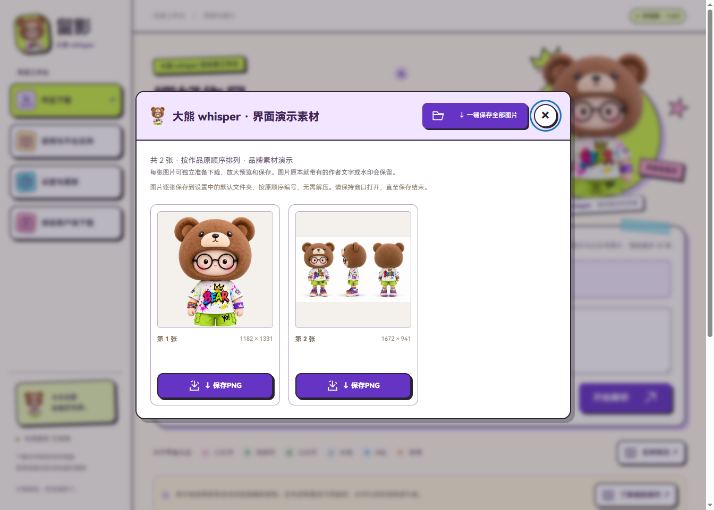
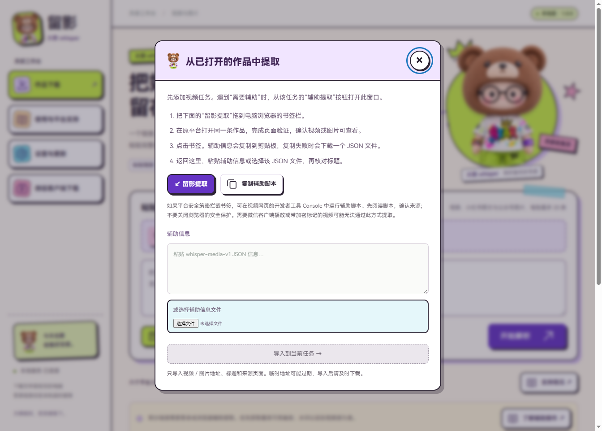
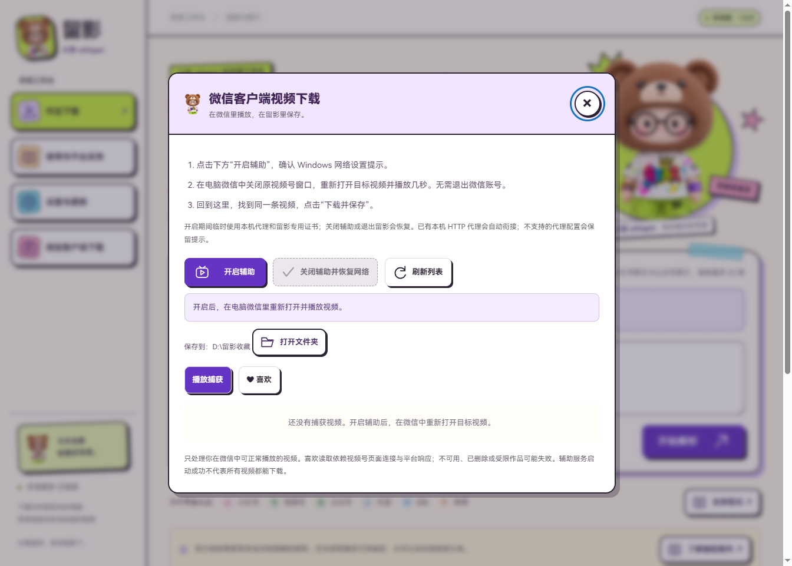
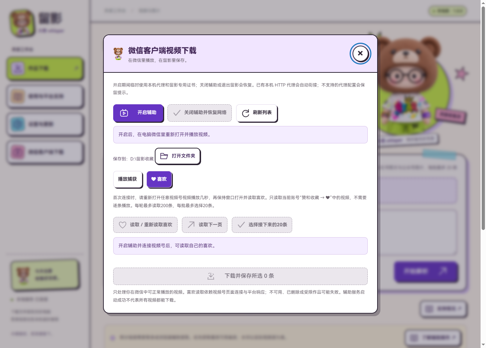
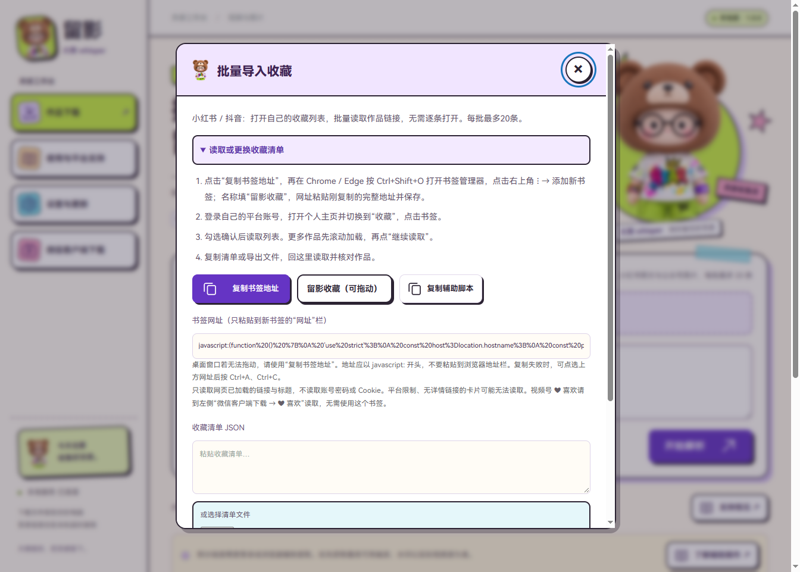
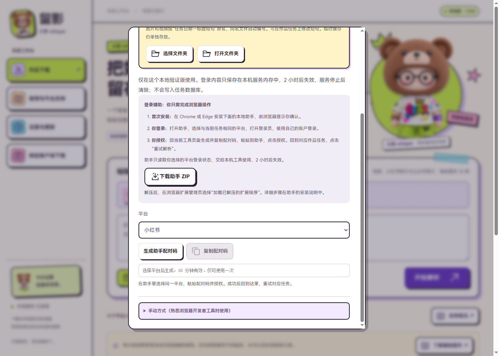
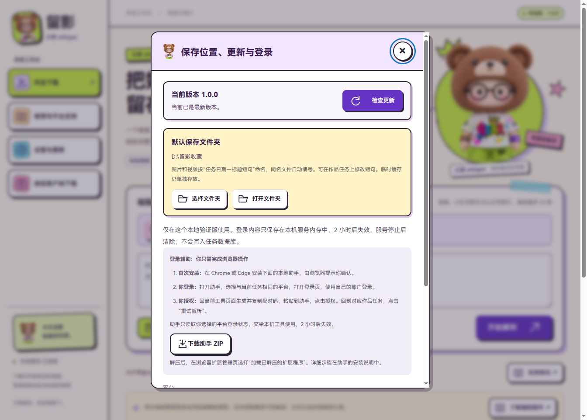

# 留影 V1 新手图文使用指南

适用：Windows 10 / 11 x64，V1 正式版（1.0.0，包含此前 0.3.9 的功能）。[返回产品首页](../README.md) · [下载 Windows 安装包](https://github.com/Whisper-5122/liuying/releases/download/v0.3.4-beta.1/Liuying-Setup-win64.exe)

**已支持客户端更新：设置与更新 → 检查更新 → 立即更新。** 0.3.6～0.3.9 与 V1 在更新源可用时可这样操作；更早且没有配置更新源的版本，先覆盖安装 V1 一次。[查看升级说明](#版本更新)。

按需求跳转：

- [安装与第一次保存](#安装与保存)
- [公众号文章图片 / 图片帖 / 贴图](#公众号图片)
- [微信视频号：单条与 ❤ 喜欢](#视频号)
- [小红书 / 抖音收藏批量导入](#收藏批量导入)
- [需要登录时的浏览器助手](#登录助手)
- [客户端更新与覆盖安装](#版本更新)
- [常见问题与反馈](#常见问题)

## 一、安装与第一次保存

### 下载和安装

1. 点击上方下载链接，不需要注册 GitHub，也不用点绿色 Code。
2. 下载 `Liuying-Setup-win64.exe`。正式版本页的 `Liuying-Setup-1.0.0-win64.exe` 也是同一 V1 安装包。不要下载 `Source code` 源码 ZIP。
3. 双击 `.exe` 按提示安装；已有留影时先关闭，保留原安装目录，不需要先卸载。
4. 打开桌面「留影」。若安装程序提示缺少 WebView2，按提示联网安装；Python 和 FFmpeg 已打包。

安装包未作 Windows 代码签名，电脑可能显示信誉提示。核对来源是本项目，按自己电脑的安全策略处理；公司电脑受限时请找管理员。更新清单的数字签名用于校验更新来源，与 Windows 代码签名是两回事。

### 认识主页

| 入口 | 用途 |
| --- | --- |
| 作品下载 | 粘贴完整分享文字，解析视频 / 图文，管理任务 |
| 微信客户端下载 | 从电脑微信播放捕获视频，或读取视频号 ❤ 喜欢 |
| 设置与更新 | 检查新版、选择保存文件夹、按需配对登录助手 |
| 批量导入收藏 | 从自己的小红书 / 抖音收藏页读链接 |
| 下载任务 | 核对标题，准备、预览、保存或重试 |

### 普通链接四步操作

1. 平台选「分享 / 复制链接」，把**完整分享文字**粘贴到主页，多条链接可换行，一批最多 20 条。
2. 点「开始解析」。想自动准备文件，先勾选「解析后自动准备文件」。
3. 核对任务的标题、作者和来源。未自动准备时，按提示点「准备视频文件」或准备图片；也可用「准备全部文件」。
4. **视频：** 等待就绪 → 可先预览 →「保存 MP4」。**图片：**「查看图片」→ 单张保存或「一键保存全部图片」。

**「可保存」不等于已经另存到目标文件夹。** 请实际点保存，看到成功提示后检查文件夹。任务缓存保留 24 小时，不能当永久素材库。默认保存到 Windows 下载文件夹，可在「设置与更新 → 默认保存文件夹」选择路径并打开文件夹。

文件按“任务日期－标题短句”命名，图片加顺序编号，同名文件自动编号；任务上的「文件命名」可修改短句。保存全部图片时保持窗口打开直到结束。

## 二、微信公众号：文章图片 / 图片帖 / 贴图

「贴图」指文章或作品内的图片 / 图片帖，不指表情包商店。此处支持公众号发布图片，不能据此保证文章中所有内嵌视频都可下载。

### A. 先直接解析，不用一开始就装助手

1. 微信打开原文章 / 图片帖，复制**原文链接**，通常以 `https://mp.weixin.qq.com/` 开头。
2. 粘贴到留影主页 →「开始解析」。
3. 看到「查看 N 张图片」后打开，核对文章，再保存一张或全部。

能直接读到就完成了。图片按正文 / 图片帖顺序排列，GIF 保留格式，原图的文字与标识也保留。

### B. 受限、需要辅助或读不到图片

用浏览器 **「留影提取」** 书签，读取你自己已经能查看的那篇文章。

**第一步：打开同一文章。** 电脑 Edge / Chrome 打开当前任务对应的原文，自己完成验证 / 登录，向下滚动加载图片，确认能正常看到。

**第二步：打开留影辅助窗口。** 点该任务的「辅助提取」，窗口标题为「从已打开的作品中提取」。从目标任务进入，避免导错作品。

**第三步：首次建书签。** 可以拖动时，把「↙ 留影提取」拖到浏览器书签栏。桌面窗口拖不动时用以下方法，建一次以后继续用：

1. 留影点 **「复制辅助脚本」**。
2. 回浏览器，在任意普通网页按 **Ctrl+D**，命名 **「留影提取」**，保存到收藏夹栏 / 书签栏。
3. 按 **Ctrl+Shift+O** 打开收藏夹 / 书签管理器，找到「留影提取」，右键 → **编辑**。
4. 将 **网址 / URL** 全部替换：先输入 `javascript:`，**紧接着**粘贴刚复制的完整脚本，再保存。粘在书签的“网址”栏，中间不用空格。
5. Edge 中叫收藏夹管理器，Chrome 中叫书签管理器。找不到书签栏可按 **Ctrl+Shift+B** 显示。

> 「复制辅助脚本」复制的是脚本本身，**需要自己加一次 `javascript:` 前缀**。不要粘贴到浏览器顶部地址栏，否则可能删除前缀或变成搜索。只使用本机留影提供的脚本。

**第四步：提取。** 切回同一篇文章网页，点击浏览器的「留影提取」书签。成功会复制辅助信息，复制失败时可能下载一个 `.json` 文件。提示可能写“已复制视频辅助信息”，该脚本同样可携带文章图片。

**第五步：导入并保存。** 回留影，把结果粘到「辅助信息」，或选择刚下载的 JSON → **「导入到当前任务」** → 核对标题 →「查看图片」→ 保存。JSON 是辅助信息，不是图片，需要导入后再保存。

| 遇到什么 | 怎么处理 |
| --- | --- |
| 拖不动书签 | 用上述手动编辑方法 |
| 点书签变成搜索 | 检查书签网址的 `javascript:` 前缀，别贴到地址栏 |
| 无可提取内容 | 确认是原文详情页，滚动加载后再点；不要在分享卡片 / 验证页提取 |
| 来源不匹配 | A 文章不能导入 B 任务，回同一原文重新提取 |
| 没复制，也没下载 JSON | 页面可能拦截书签，换能正常访问的原文页重试 |
| 地址过期 | 回原网页重新提取，导入后及时保存 |

熟悉开发者工具的用户：可选 Console 方法

仅在理解脚本内容时，可在同一原文页的开发者工具 Console 运行留影复制的辅助脚本。不要关闭浏览器保护，不要绕过阻止粘贴的提示。不熟悉就继续用书签方式；平台限制 / 加密仍可能导致失败。

此提取脚本导出作品媒体地址、标题与来源，不导出 Cookie。**公众号图片不需要开启「微信客户端下载」网络辅助。**

## 三、微信视频号：单条视频与 ❤ 喜欢

用 **Windows 电脑微信**，不是手机微信或公众号浏览器页面。建议走左侧专用入口；分享卡片解析成功不代表已取得可保存视频。

### A. 保存正在播放的一条视频

1. 左侧 **「微信客户端下载」** → **「播放捕获」**。
2. 点 **「开启辅助」**，阅读并确认网络 / 证书提示。它会临时使用本机代理和留影专用证书。
3. 电脑微信中**关闭之前的视频号窗口**，重新打开目标视频播放几秒。无需退出微信账号。
4. 回留影 **「刷新列表」**，按标题 / 作者找到同一视频 → **「下载并保存」**，等待完成。
5. 点 **「打开文件夹」**确认文件能播放。完成后点 **「关闭辅助并恢复网络」**。

**只关闭面板不会停止辅助。** 请点“关闭辅助并恢复网络”，或退出留影。正常停止 / 退出会恢复原设置；异常退出后可重开留影按提示恢复，确认状态再继续。

「辅助已开启」不等于「已连接微信」。没有捕获记录时，先关闭旧视频窗口，再重开播放并刷新，不用反复退出账号。请先确保该视频在自己的电脑微信里能正常播放。

### B. 批量下载视频号 ❤ 喜欢

1. 先开启辅助，在微信重新打开任意视频号视频并播放几秒，**保持这个微信视频窗口打开**。
2. 留影切到 **「❤ 喜欢」** → **「读取／重新读取喜欢」**。
3. 核对标题，每批最多勾选 **20 条**；也可用「选择接下来的20条」。
4. 点 **「下载并保存所选」**，等本批完成，检查文件夹。需更多时点「读取下一页」，每轮最多 **200 条**。
5. 完成后 **「关闭辅助并恢复网络」**。

读的是**视频号「赞和收藏 → ❤」**，不是微信聊天通用收藏，更不是小红书 / 抖音收藏。空列表时保持微信视频窗口打开，重新播放后重新读取。失效、无权限或加密视频可能无法下载。

### 网络与兼容性

已有本机 HTTP 代理可衔接；PAC、按协议或远程代理可能不支持，按软件提示处理。历史真实验证使用微信 **4.1.15.13**，账号、网络与微信更新会影响结果，不能保证所有版本可用。❤ 喜欢真实样本来自 0.3.8，后续做了回归检查；本文截图展示入口，没有开启真实捕获。

## 四、小红书 / 抖音：导入自己的收藏

用 **「留影收藏」** 书签读当前收藏页已加载的作品链接，再分批解析。它与单条「留影提取」、视频号 ❤ 喜欢是三个不同入口。

### 首次建收藏书签

1. 主页 **「批量导入收藏」** → **「复制书签地址」**。
2. Edge / Chrome 任意普通网页按 Ctrl+D，建 **「留影收藏」**。
3. Ctrl+Shift+O 打开管理器，右键此书签 → 编辑，将**网址**换成刚复制的完整内容 → 保存。

**这里复制的完整地址已经有 `javascript:`，不用再加。** 与公众号的“复制辅助脚本”不同。不要粘到浏览器顶部地址栏，桌面拖不动也用上述方式。

### 读取、导入和保存

1. 浏览器自行登录自己的小红书 / 抖音，进入 **个人主页 → 收藏**。
2. 点击浏览器「留影收藏」书签，勾选确认是自己的收藏后读取。
3. 想读更多，先向下滚动加载卡片，再点「继续读取」。没加载的历史作品不能读取，没有详情链接的卡片可能跳过。
4. 复制清单或导出 JSON，回留影「批量导入收藏」，粘到 **「收藏清单 JSON」** 或选择清单文件 → **「读取清单」**。
5. 核对作品，每批最多选 **20 条** → **「添加所选作品」**，可勾选自动准备。每轮最多 200 条。
6. 回下载任务查看进度，就绪后 **「批量保存已就绪」**，或逐条保存。没准备好的任务先等或单独处理。
7. 当前会话已有的正常任务会跳过，失败任务可重新添加；受限作品仍需对应平台的登录 / 提取辅助。

收藏清单只是链接列表，导入不等于已保存作品。此书签不读账号密码 / Cookie，只读页面作品链接与标题。

## 五、任务要求登录时：浏览器登录助手

普通作品先直接解析；读取当前文章用单条提取。**只有任务提示需要登录时，再装这个扩展。** 由你自行登录并配对，不用把密码发给任何人。

### 首次安装扩展（一次）

1. 留影 **「设置与更新」** 向下滚动 → **「下载助手 ZIP」**。
2. 将 ZIP **解压**到固定文件夹，不要直接在 ZIP 内打开。
3. Edge 地址栏输入 `edge://extensions`；Chrome 输入 `chrome://extensions`。
4. 开启 **开发人员模式 / 开发者模式** → **加载解压缩的扩展 / 加载已解压的扩展程序**。
5. 选择**含 `manifest.json` 的文件夹**，不是文件本身或未解压 ZIP，按浏览器提示确认。可把扩展固定到工具栏。

### 配对并重试（需要时）

1. 打开扩展，选当前任务平台，在平台网页自己完成登录。
2. 回留影选**同一平台** → **「生成助手配对码」** →「复制配对码」。
3. 粘到扩展并授权。配对码 10 分钟有效、仅用一次，过期重新生成。
4. 回目标任务 **「重试解析」**，然后准备并保存。

授权仅在本机服务内存使用，约 **2 小时**后失效，退出 / 更新重启后清除，不写任务数据库。浏览器通常仍登录着；重新配对不等于一定要重输密码。不要公开 Cookie、配对码或辅助 JSON。

设置里视频号可能显示腾讯元宝辅助；小白优先使用前章的 **「微信客户端下载」**，按播放捕获 / ❤ 喜欢操作。登录辅助不能保证突破平台限制。

## 六、版本更新：能在客户端一键更新吗？

**能。V1 已配置固定签名更新源。**

1. 等当前下载 / 保存完成。
2. 左侧 **「设置与更新」** → **「检查更新」**。
3. 发现新版本后阅读说明 → **「立即更新」**；已下载完成时可能显示「安装更新」。
4. 保持软件开启与网络连接。软件会下载完整包，验证签名和 SHA-256，安装并重新打开。
5. 再进设置确认版本。没有新版时显示已是最新版本。

| 当前情况 | 升级方式 |
| --- | --- |
| 0.3.6～0.3.9，更新源可用 | 客户端检查并更新到 V1（1.0.0） |
| V1 以后 | 发布更高版本后，同样在客户端更新 |
| 0.3.5 及更早、未配置或按钮不可用 | 退出留影，用上方安装包按原目录覆盖安装 V1 一次；以后客户端更新 |
| 早期版本曾修复更新源，已检测到 V1 | 直接客户端更新 |
| 检查更新网络失败 | 先重试；仍失败可下载本页安装包覆盖安装 |

一键更新是**你点击后自动完成下载安装**，不会未经点击就静默升级。网络失败不等于需要重装。

### 会丢记录或需要重登录吗？

- 按原目录覆盖安装，任务数据、保存位置、已另存的文件都会保留，不用先卸载。
- 临时登录授权随重启清除，受限作品可能要重新配对；浏览器通常仍登录，不一定需要重输密码。
- 缓存仍按原保留策略管理，要长期保存请另存到文件夹。
- 有下载 / 保存任务时按提示等待后再更新。

### 原分享链接是否保留？

保留。继续转发原产品页即可：

- [原产品分享页](https://github.com/Whisper-5122/liuying#readme)
- [原发布页，当前下载入口为 V1](https://github.com/Whisper-5122/liuying/releases/tag/v0.3.4-beta.1)
- [原固定 Windows 下载](https://github.com/Whisper-5122/liuying/releases/download/v0.3.4-beta.1/Liuying-Setup-win64.exe)
- [正式 V1 版本说明](https://github.com/Whisper-5122/liuying/releases/tag/v1.0.0)

旧直链名称即使含 0.3.4，也是为兼容保留的地址；安装后以设置版本为准。历史文件另行归档，**不要下载 `archive-` 开头的文件作为最新版**。

## 七、常见问题与反馈

| 问题 | 下一步 |
| --- | --- |
| 手机能装吗 | 当前 Windows 桌面版，手机不能装 `.exe`，手机网页服务未发布 |
| 链接识别失败 | 从原作品复制完整分享文字，不要只复制标题 / 截图，不要删链接参数 |
| 文件夹里没有作品 | 确认真正点了保存，再从设置点打开文件夹；“可保存”只是就绪 |
| 画质不够高 / 有水印 | 以平台当前可用源为准，不移除原图 / 视频内嵌文字与水印 |
| 公众号图片不全 | 同一原文在浏览器滚动加载，再辅助提取 |
| 微信没有捕获 | 关旧视频窗口再重开播放，保持窗口打开后刷新 |
| ❤ 喜欢为空 | 确认视频号“赞和收藏 → ❤”，重新连接再读取，不是通用微信收藏 |
| 收藏数量少 | 平台页面先加载更多卡片再读，每轮最多 200 条，只读已有详情链接 |
| 下载失败 | 确认原平台可正常查看，按任务提示辅助 / 登录后单独重试 |
| 安装后仍是旧版 | 关闭旧窗口，用原目录覆盖，再从桌面打开并确认设置版本 |
| 网络 / 代理异常 | 点关闭辅助并恢复网络，重开留影按恢复提示操作；反馈是否异常退出 |

反馈请提供：**留影版本、Windows / 微信版本、平台、操作到哪一步、完整错误文字、去隐私截图**，以及自己有权公开的作品链接。不要公开登录凭据、私人收藏清单、临时签名媒体地址。[提交问题](https://github.com/Whisper-5122/liuying/issues/new)。

截图来自 V1 原生桌面的独立演示资料，无真实账号 / 配对码。图集为自有品牌素材；微信截图未开启网络辅助。历史真实样本成功不代表所有内容均可下载，请只保存自己有权保存和使用的作品。
