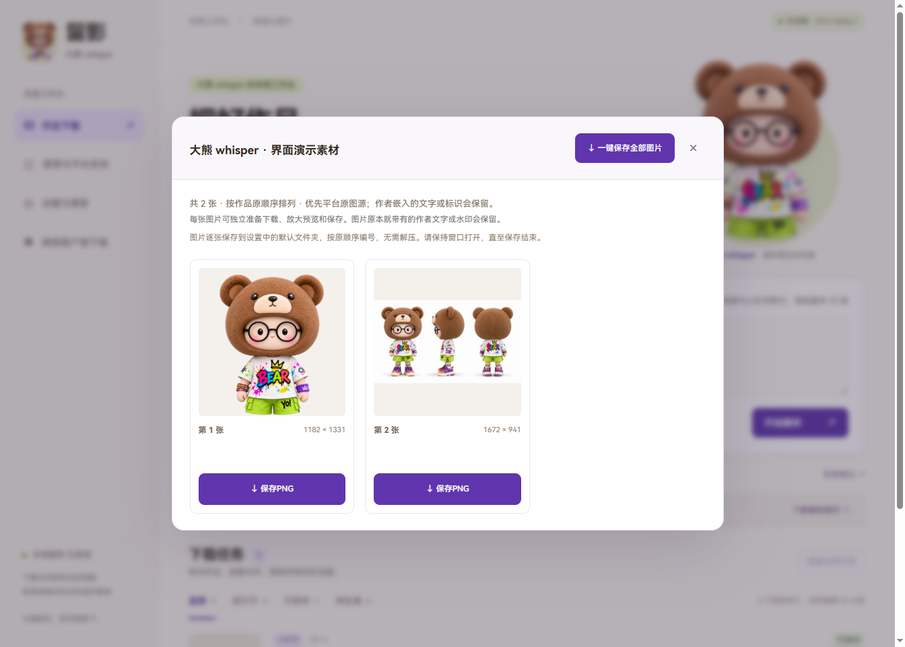
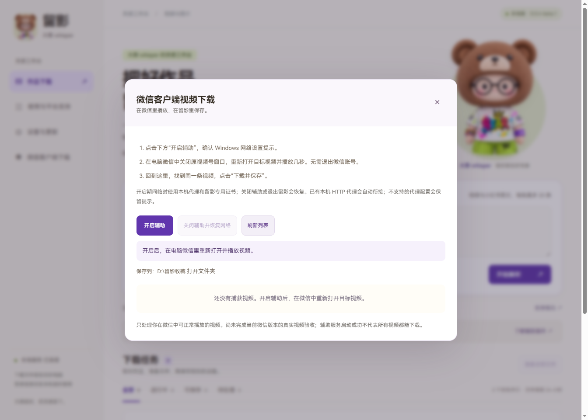
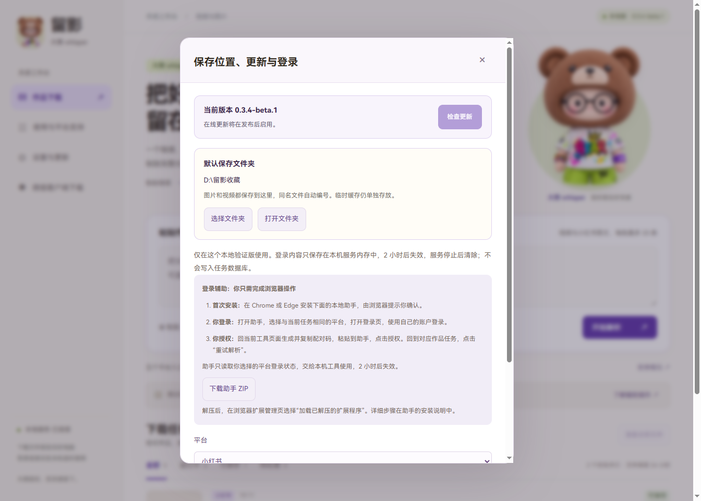

# 留影安装与使用指南

[返回介绍页](../README.md) · [下载安装包](https://github.com/Whisper-5122/liuying/releases/download/v0.3.4-beta.1/Liuying-Setup-0.3.4-beta.1-win64.exe)

## 首次安装

1. 下载 `Liuying-Setup-0.3.4-beta.1-win64.exe`，双击安装。
2. 安装完成后打开桌面上的「留影」。不需要安装 Python 或 FFmpeg。
3. 缺少 WebView2 时，安装程序会联网安装运行时，请保持网络连接。

当前为 Windows x64 测试版，未做 Windows 代码签名。请从本仓库 Releases 下载，可用同页的 SHA256SUMS.txt 核对完整性。

## 保存普通视频

1. 在原平台复制作品的完整分享内容。
2. 在留影中粘贴，点击「开始解析」。每批最多 20 条链接。
3. 核对标题与来源，点击「准备视频文件」，或提前勾选自动准备。
4. 文件就绪后可以预览，点击「保存 MP4」另存到默认文件夹。

如果任务失败，先看任务上的错误提示，再决定重试或使用登录辅助。当前单条视频上限为 2 GB。

## 保存小红书图文

解析后点击「查看图片」。按原顺序浏览，可单张准备、预览与保存，也可点击「一键保存全部图片」。桌面版会使用设置中的保存位置，同名文件自动编号，无需解压。

## 保存微信客户端视频

左侧「微信客户端下载」→「开启辅助」并确认提示→在电脑微信重新打开视频并播放几秒→回到留影选择「下载并保存」。

开启期间会临时使用当前用户代理和留影专用证书。关闭辅助或退出应用会恢复原设置；不需要退出微信账号。不支持的网络代理配置会显示说明，请先处理提示后再试。

## 更改保存位置

打开左侧「设置与更新」，在「默认保存文件夹」点击「选择文件夹」。选定后，图片和视频共用这个目录，重启或正常覆盖升级后保留。同名文件自动编号，不覆盖已有成果。

另存成果与临时缓存分开。缓存保留 24 小时，不会按这个规则清理你已经另存的图片和视频。

## 解析失败时怎么处理

| 看到的情况 | 先做什么 |
| --- | --- |
| 提示链接无效 | 重新复制原平台的完整分享文本，确认作品仍可打开 |
| 需要登录或访问受限 | 在「设置与更新」按助手说明同步自己的浏览器登录状态，再点任务「重试解析」 |
| 微信网页解析失败 | 改用「微信客户端下载」，在电脑微信中重新打开并播放视频 |
| 微信辅助没有启动 | 阅读窗口保留的错误提示，处理代理或组件问题后重试，避免反复播放视频 |
| 文件就绪但没找到成果 | 点击任务上的保存按钮，再检查「设置与更新」中的默认文件夹 |
| 保存失败 | 检查文件夹权限、磁盘空间与文件夹是否仍可用 |

仍然失败时，请到 [Issues 反馈](https://github.com/Whisper-5122/liuying/issues/new)，提供版本、系统、平台、操作步骤和错误提示。不要贴出 Cookie、配对码或账号凭据。

## 升级旧版

先关闭留影，下载新安装包，覆盖安装到原目录。任务、设置和已保存成果位于安装目录之外，正常升级会保留。当前线上自动更新源尚未启用，请使用 Releases 提供的安装包升级。

## 关于截图和支持范围

截图来自 0.3.4 桌面界面的独立演示配置；图集采用大熊 whisper 品牌素材，不包含用户的真实任务和账号。截图用于说明界面与操作，不代表新增平台下载验收。

平台可用性、Windows 验证范围与第三方许可证条件见 [介绍页](../README.md#平台支持与实际验证)。
